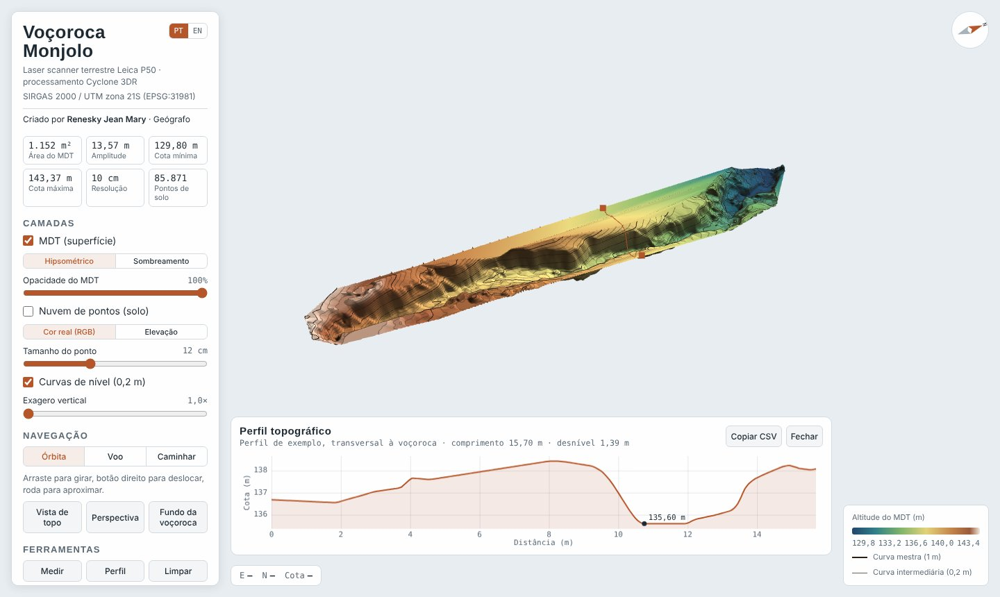
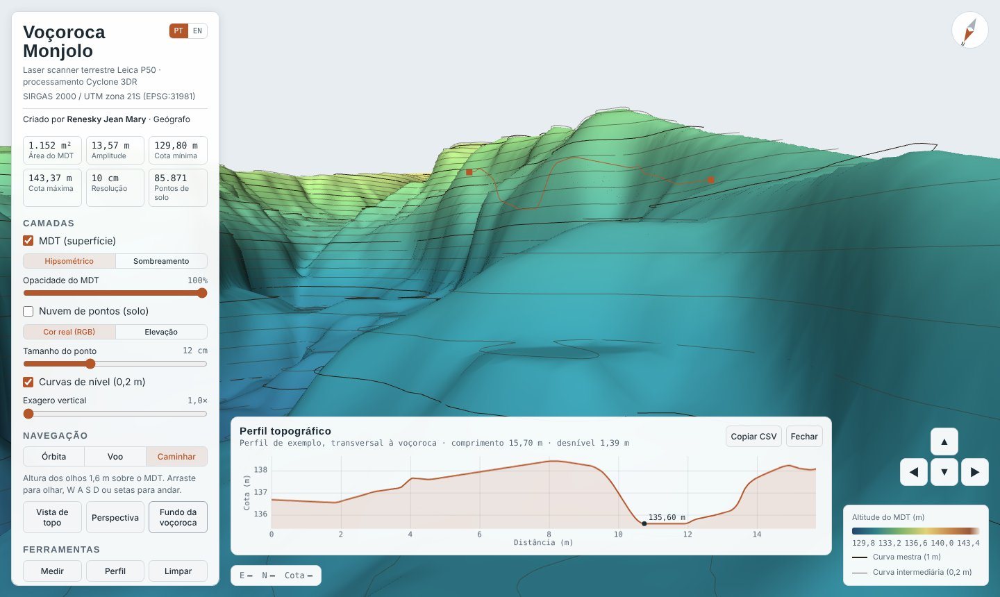
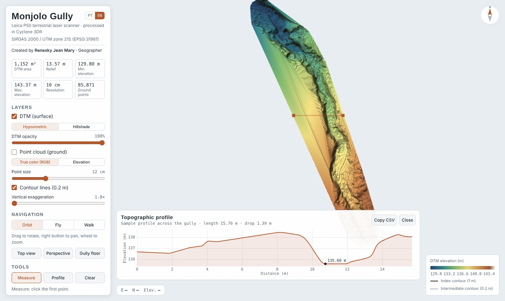
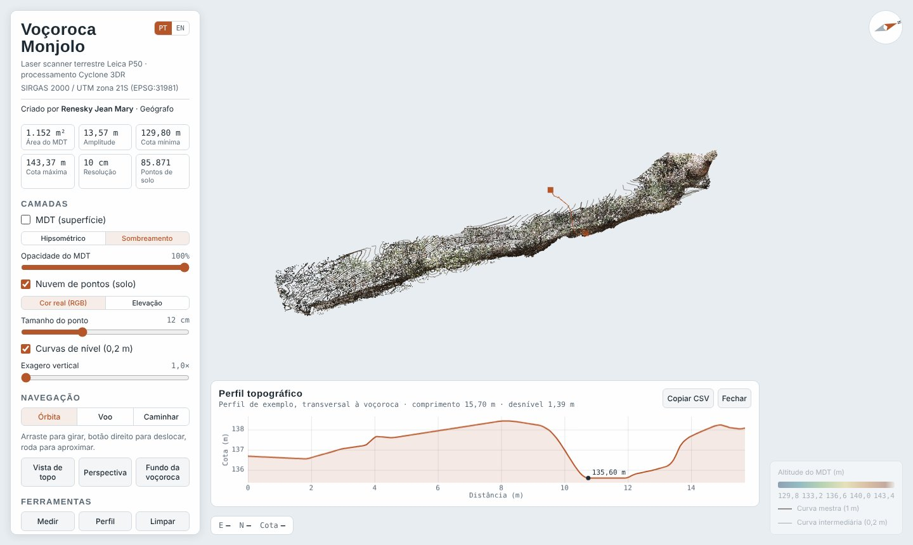

# Voçoroca Monjolo 3D: visualizador web do MDT, das curvas de nível e da nuvem de pontos de solo

Visualizador 3D que roda no navegador para explorar uma voçoroca monitorada com laser scanner terrestre. Mostra o modelo digital do terreno (MDT) em cores de elevação, as curvas de nível e a nuvem de pontos de solo. Tem medição, perfil topográfico e um modo para caminhar dentro da voçoroca. Foi feito para que os membros do grupo de pesquisa em feições erosivas vejam e discutam o levantamento sem instalar nenhum programa.

Autor: **Renesky Jean Mary**, geógrafo

**▶ Usar online:** https://renesky26-coder.github.io/vocoroca-monjolo-3d/



## Funcionalidades

| Recurso | O que faz |
|---|---|
| **MDT 3D** | Superfície do terreno com rampa hipsométrica ou sombreamento neutro, opacidade ajustável e exagero vertical de 1× a 4× |
| **Curvas de nível** | Equidistância de 0,2 m, com as curvas mestras de 1 m em destaque |
| **Nuvem de solo** | Pontos de solo (classe 2) em cor real (RGB) ou por elevação, com tamanho de ponto ajustável |
| **Navegação** | Órbita, voo e **caminhar** (câmera a 1,6 m sobre o MDT); atalhos para vista de topo, perspectiva e fundo da voçoroca |
| **Medir** | Distância 3D, distância horizontal, desnível (ΔZ) e declividade entre dois pontos |
| **Perfil topográfico** | Perfil entre dois pontos, com gráfico interativo e cópia em CSV (distância, E, N, cota) |
| **Coordenadas** | E, N e cota sob o cursor, em SIRGAS 2000 / UTM 21S |
| **Idiomas** | Português e inglês |

<p>


</p>
<p>

</p>

## Dados

| Item | Valor |
|---|---|
| Levantamento | Laser scanner terrestre Leica P50 |
| Processamento | Cyclone 3DR (limpeza de ruídos, classificação do solo, MDT e curvas) |
| Sistema de referência | SIRGAS 2000 / UTM zona 21S (EPSG:31981) |
| MDT | 10 cm de resolução, 1.152 m² de área, cotas de 129,80 a 143,37 m |
| Nuvem de solo | 85.871 pontos com cor RGB |
| Curvas de nível | 0,2 m de equidistância |

Os arquivos em `data/` são versões compactas dos produtos originais: alturas do MDT em milímetros (inteiros de 16 bits), coordenadas da nuvem em passos de 2 mm e curvas em coordenadas locais. O script `ferramentas/converter_dados.py` gera esses arquivos a partir do GeoTIFF, do LAS e do Shapefile.

## Como navegar

- **Órbita:** arraste para girar, botão direito para deslocar, roda do mouse para aproximar.
- **Voo:** arraste para olhar; `W` `A` `S` `D` ou setas para mover, `Q` / `E` para descer e subir, `Shift` acelera.
- **Caminhar:** igual ao voo, mas a câmera acompanha o terreno a 1,6 m de altura. No celular, use as setas na tela.
- **Medir / Perfil:** escolha a ferramenta e clique em dois pontos do terreno.

## Atualizar os dados

1. Exporte do Cyclone 3DR (ou do QGIS) o MDT em GeoTIFF, a nuvem de solo em LAS e as curvas em Shapefile.
2. Rode o conversor (precisa de `numpy`, `rasterio`, `laspy` e `pyshp`):
   ```
   python ferramentas/converter_dados.py pasta_dos_dados data
   ```
3. Envie a pasta `data/` atualizada. O GitHub Pages publica a nova versão em alguns minutos.

## Tecnologia

Uma página HTML com [three.js](https://threejs.org/) r147 (licença MIT), carregado do jsDelivr. Não há servidor nem banco de dados: tudo roda no navegador.

## Licença

O código está sob a licença MIT (arquivo `LICENSE`). Os dados do levantamento em `data/` pertencem ao autor e ao grupo de pesquisa; para reutilizá-los em outros trabalhos, entre em contato com o autor.
